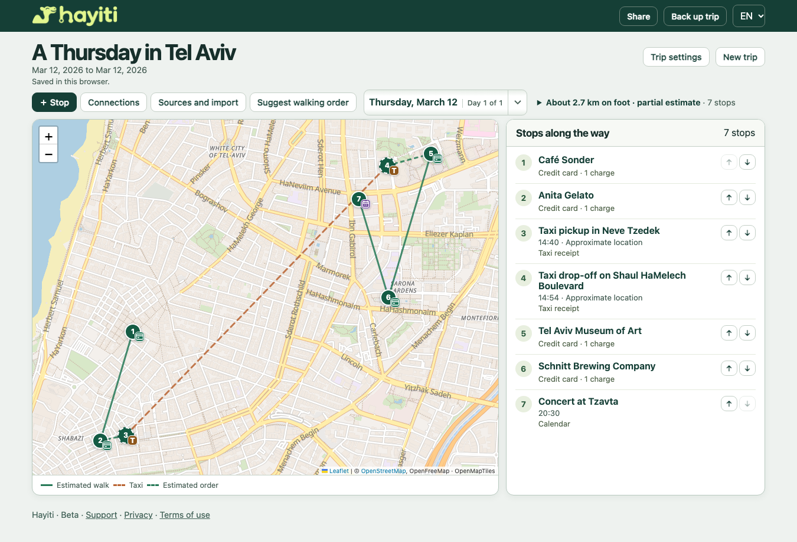
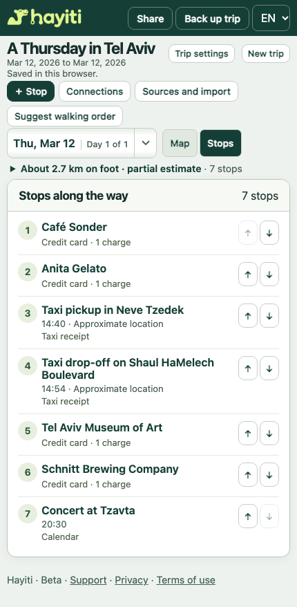

<h1></h1>

hayiti is a trip journal that works with [ChatGPT](https://chatgpt.com/) and its [Finances tab](https://chatgpt.com/finances/). ChatGPT helps you piece together each day from the sources you choose. A card purchase might tell you where you ate, a taxi receipt in Gmail might show where you went next, and Google Calendar might remind you of a concert that evening. You choose which stops to save and can add anything else you remember by hand.

After a long trip, whole days blur together. A friend asks where you ate, and you can picture the place but the name is gone. Your receipts still have a place and a date on them. Start with one stop and piece together the rest a day at a time, even if you never wrote a journal entry while you were away.

[Open the web app](https://hayiti-beta.cocoacoati256.chatgpt.site) · [Download the portable journal](https://hayiti-beta.cocoacoati256.chatgpt.site/Hayiti.zip) · [Read the story: “Hey Dot, Can You Map Where I Went?”](https://mrrubin.substack.com/p/hey-dot-can-you-map-where-i-went)

## Build a trip in ChatGPT

With hayiti connected, start in chat. For example:

> Map my trip to Tel Aviv last week. I stayed near the market. Use my receipts and calendar to work out where I went each day.

ChatGPT can ask for missing dates or a home base, then cross-check the sources you authorize. A Gett receipt can put a pickup and drop-off on the map where a card charge alone only shows a fare. A photo you share can help identify a place when its location is known. Only the local capture time and GPS coordinates are needed. On each day, photo locations within 100 metres of a saved photo pin share that pin. The earliest known capture supplies the displayed pin. The grouping radius stays fixed, so a walk across several blocks can still add new stops.

Review the suggested stops in chat and tell ChatGPT which to save. Open the journal with the same account to see your daily routes, change the home base, edit stops or share a read-only map. To add evidence later, use **Sources and import** in that trip.

Each trip opens on a day. Choose **Whole trip** to see all its days on one map. Each day's route is drawn separately. Choose streets, satellite imagery or a topographic map in either view.

Ask ChatGPT to add saved places from a Google Maps list it can read. A **Google Pin** is a bookmark. It appears on its assigned day and in the trip overview, independently of visit counts and route distances. Pins without a known trip day appear in the overview, where you can assign a day yourself. A save timestamp, when available, records when you bookmarked the place. Removing a pin keeps it out of later imports for that trip. To bring it back, import a saved-places file containing it, then choose **Restore a removed pin** in the preview.

Using the portable journal, or the web app without signing in? The sync request asks ChatGPT for a JSON file. Import that file into your trip under **Sources and import** → **Files**.

Agents connecting over MCP receive the trip-building instructions during initialization. The [Map My Trip skill](skills/map-my-trip/SKILL.md) covers source checks, identifying the correct venue, resolving visit order, and saving the route. For an untimed purchase the agent checks branch-specific hours and the traveler's account before using distance to break a tie. A booking time or a bank posting can differ from the time of a visit.

## A Thursday in Tel Aviv

The sample trip shows how the pieces fit together. Card receipts put you at Café Sonder by the Carmel Market and Anita Gelato in Neve Tzedek. The taxi receipt fills in what card charges can’t. Pickup in Neve Tzedek at 2:40 p.m., drop-off on Shaul HaMelech Boulevard fourteen minutes later. Two more charges follow, at the Tel Aviv Museum of Art and Schnitt Brewing Company, and the calendar has a concert at Tzavta at 8:30.



The orange dashed line shows the taxi ride. Place names on the street map follow the journal's language, English or Hebrew, and fall back to the local name. [OpenFreeMap](https://openfreemap.org/) · [© OpenMapTiles](https://openmaptiles.org/) · [© OpenStreetMap contributors](https://www.openstreetmap.org/copyright)

The [downloadable example](https://hayiti-beta.cocoacoati256.chatgpt.site/sample-trip.json) contains all seven stops. Taxi pins show approximate locations. In an empty journal, choose **Try the sample trip**. To add it next to your own trips, open **Sources and import**, choose **Files**, select the JSON and choose **Load trip**.

## Add an event manually

1. Open the web app, or unzip the portable journal and open `Hayiti.html` in your browser.
2. Select a trip or choose **New trip** and enter its name and dates.
3. Pick the day, choose **+ Stop**, and enter a **Place or event name**. Add a time or address if you know it, then choose **Save**.

To add stops from a file, use **Sources and import** to bring in a transaction CSV or a calendar file.

Without signing in, the web app keeps your trips in that browser. Use **Back up trip** to keep an editable copy or move it to another device. Use **Share** to give someone a read-only route. The portable journal saves edits in browser storage when available. You can import, edit and export offline. Saving a stop with an address and no map pin looks the address up and adds the pin. Loading the street map and looking up addresses require internet access. Offline, pins and routes are drawn without the streets.

On a phone, choose **Stops** to see the day’s visits in order.



## How it finds a route

- **Imports.** Create or select a trip before importing transactions (`.csv`), calendar events (`.ics`) or email (`.eml`). A transaction CSV needs a date and merchant name. A trip backup (`.json`) can open a trip in an empty journal. You can also place a pin by hand.
- **Matching.** hayiti checks the day and source reference before adding a stop. Independent records with matching places, compatible times and compatible addresses can corroborate one visit. Ambiguous matches stay separate for review.
- **Order and distance.** Date, time, ordering rules and location inform the suggested order. Each adjacent pair can carry its own route. Walking is the estimate for each pair unless evidence identifies a different mode. This includes longer walks and crossings between cities. A taxi ride matched to the pair follows the driving network. When directions are unavailable, the journal keeps its existing route or estimated connector. Walking totals use recorded walking segments.
- **Source status.** Each requested source has a dated status. Finances distinguishes a disconnected source, missing credit or debit accounts, zero transactions and purchases without a mappable place. Gmail and Calendar can contribute independently.
- **Sharing.** Share a day or trip as a read-only route. The shared version omits notes, photos, private Google Pins and source references. The home base is excluded by default. A hosted link can be revoked. A downloaded copy stays with its recipient.

## Build from source

You need Node.js 26 LTS and npm. Node.js 24.12 or later on the 24.x line also works, and CI checks both. From the repository root, run these commands.

```sh
npm ci
npm run build
```

Open `dist/web/Hayiti.html` directly in your browser. The build also creates `dist/web/Hayiti.zip` for distribution and `dist/server/app.mjs` for the hosted journal.

TypeScript 7 checks the application, tests and build scripts. Type-aware ESLint uses the TypeScript 6 compiler API.

## Reading the code

| Start here | Responsibility |
| --- | --- |
| [Trip and Stop](src/domain/core.ts) | Typed domain model, validation and evidence matching |
| [Importers](src/domain/importers.ts) | CSV, calendar and pasted evidence, plus suggested stop order |
| [Daily route](src/domain/daily-route.ts) | Map sequence and walking-distance calculations |
| [Sharing](src/domain/share-format.ts) | Builds a shareable snapshot from an explicit list of allowed fields |
| [Journal UI](src/web/journal-app.ts) | The browser application |
| [HTTP entry point](src/server/app.ts) | Routes authenticated journal requests, MCP requests and shared views |
| [Object storage](src/server/storage.ts) | Per-user records and conditional writes that prevent lost edits |
| [Tests](test) | Matching, permissions, sharing and an offline Chromium round trip |

## Hosted integration

The build produces browser assets in `dist/web/` and an ES module in `dist/server/app.mjs`. A host calls `handleRequest(request, bindings, verifiedUserId, serveAsset)`. The host authenticates the session or OAuth token and supplies the verified user ID, or `null` for anonymous requests. Configure the sign-in endpoint on that host. Running the portable file needs no account.

Provide a private R2-compatible `BUCKET` and your HTTPS `PUBLISHER_ORIGIN`. To enable hosted sharing, set `HAYITI_SHARE_RELAY` as a host secret. An optional companion journal can set the same secret and use its own origin as `RELAY_ORIGIN` on the publisher. Use the same publisher origin on both hosts. See [the binding types](src/server/storage.ts).

ChatGPT connects to the hosted journal using OAuth and the [MCP connection manifest](directory/mcp.json). With hayiti connected, try asking “Which trips are in my journal?” or “Where did I go on the first day of my trip?” ChatGPT reads trips saved to your hosted account. The portable journal keeps its own copy.

ChatGPT uses `list_trips`, `get_day` and `add_trip_stops` to reconcile approved visits. The agent uses `set_day_routes` to save estimated paths for adjacent stops on a day. A proposed order can be saved with the paths in the same operation. Supply the previously read and proposed sequences of visit, pickup and drop-off IDs in `order: {previous, next}`. A mismatch prompts a fresh read before applying changes.

### Generate directions with OSRM

An agent with access to an OSRM-compatible router can use the bundled TypeScript adapter. Configure the route URLs for the pedestrian and driving datasets available to you. OSRM's travel mode depends on the profile used to prepare each dataset. The adapter also checks the travel mode returned by the router. [OSRM API documentation](https://project-osrm.org/docs/v5.24.0/api/)

For example, two local OSRM instances might serve the pedestrian and driving datasets on ports 5001 and 5002. A plan contains only the pairs that need directions. Each pair identifies the adjacent stop IDs and endpoints in latitude, longitude order. Omit `type` for an estimated walk or specify `taxi` for a known ride.

```json
{"tripId":"example","days":[{"date":"2026-03-12","legs":[{"a":"cafe","b":"museum","from":[51.92,4.48],"to":[51.918,4.476]}]}]}
```

```sh
HAYITI_WALK_ROUTE_URL=http://localhost:5001/route/v1/foot \
HAYITI_DRIVE_ROUTE_URL=http://localhost:5002/route/v1/driving \
node scripts/route-trip.ts < plan.json > routes.json
```

Save each day's `routes` with `set_day_routes`, or open **Sources and import → Files** and import the package into the matching trip. A routing service receives endpoint coordinates. The adapter makes sequential requests and reuses repeated coordinate pairs within the same run. Pairs with no usable route are omitted and reported on stderr, preserving their previous display. A service failure stops the run before it emits a package.

## Definition of done

From a checkout with dependencies installed, run the same checks as CI.

```sh
npm run check
npx --no-install playwright-core install chromium
npm run test:browser
```

- `npm run check` verifies the TypeScript source policy, type checking and ESLint, runs the domain and server tests, and builds the portable and hosted artifacts.
- The Chromium test imports the sample Tel Aviv day offline, checks for seven map pins, reloads the journal and verifies that a shareable route is available to download.
- Before merging, the branch must be up to date with `main`, and **Verify hayiti**, **Scan TypeScript** and **CodeQL** must pass on GitHub. [CI workflow](.github/workflows/ci.yml) · [CodeQL workflow](.github/workflows/codeql.yml)

## Contributing

Use a branch and open a pull request. Describe the user-visible behavior and add a regression test for a bug fix. Use fictional trips in issues, pull requests and fixtures.

hayiti's source is licensed under [MIT](LICENSE). Leaflet, MapLibre GL JS and the MapLibre GL Leaflet layer retain their upstream licenses: [Leaflet](public/vendor/leaflet-LICENSE), [MapLibre GL JS](public/vendor/maplibre-gl-LICENSE.txt), [MapLibre GL Leaflet](public/vendor/maplibre-gl-leaflet-LICENSE.txt). The street map comes from [OpenFreeMap](https://openfreemap.org/) and uses OpenMapTiles and OpenStreetMap contributors’ data. Satellite imagery uses the [2016 Sentinel-2 cloudless mosaic from EOX](https://cloudless.eox.at/). The terrain layer uses [OpenTopoMap](https://opentopomap.org/about). The map displays credits for the active provider. See [security reporting](SECURITY.md).
